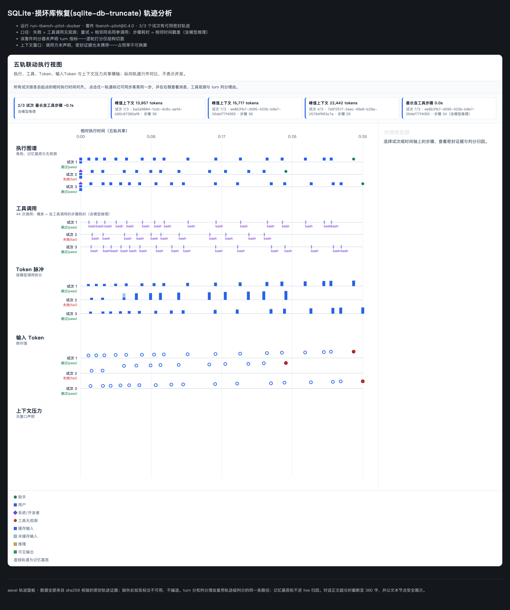

# aeval

**Deterministic, evidence-sealed evaluation for agent trajectories.**
**确定性、证据可密封的 agent 轨迹评测框架。**

[](https://pypi.org/project/aeval-harbor/)
[](https://www.python.org/downloads/)
[](https://github.com/xyrrrrr-r/aeval/blob/main/LICENSE)
[](https://github.com/xyrrrrr-r/aeval/blob/main/CHANGELOG.md)

*v0.3.0 · Apache-2.0 · Python ≥ 3.12 · `pip install aeval-harbor`*

---

aeval delegates execution to [Harbor](https://pypi.org/project/harbor/) (`harbor[e2b]==0.23.0`) and concentrates on a single question: **can the score be trusted?**

Every collected artifact is re-hashed with SHA-256 and bound to a runtime lock. If the evidence gate does not pass, the trial is rejected outright — fail loud, never a silent zero. A sealed bundle can be independently recomputed. Grading is split into an outcome layer and a trajectory layer, where threshold collapsing and veto have the final say instead of a weighted average. Reliability is measured with pass^k, not "it passed once."

aeval 把执行委托给 [Harbor](https://pypi.org/project/harbor/)（`harbor[e2b]==0.23.0`），自己专注一件事：**让"分数"可信**。每份采集产物逐一 SHA-256 校验并绑定运行时锁；证据门不通过就整条拒绝（fail loud，不给静默的 0 分）。密封 bundle 可独立复算。判分分 outcome 与轨迹两层，阈值折叠、违规 veto 终裁——不做简单加权平均；可靠性用 pass^k 度量，而不是"跑一次过了"。

[](https://github.com/xyrrrrr-r/aeval/blob/main/docs/diagrams/eval-chain.html)

*The end-to-end chain: suite → `aeval run` → host control plugin → Harbor sandbox → evidence gate → grader → veto → sealed store → report. An interactive version with guided views and a dark theme is in [docs/diagrams/eval-chain.html](https://github.com/xyrrrrr-r/aeval/blob/main/docs/diagrams/eval-chain.html).*
*端到端主链：套件 → `aeval run` → 宿主控制插件 → Harbor 沙箱 → 证据门 → grader → veto → 密封证据库 → 报告。交互版（引导视图 / 明暗主题）见 [docs/diagrams/eval-chain.html](https://github.com/xyrrrrr-r/aeval/blob/main/docs/diagrams/eval-chain.html)。*

---

## Why aeval / 为什么是 aeval

- **Grading is deterministic code, not a model's opinion.** A grader is loaded through a versioned reference (`graders/outcome.py@v7`), must prove its own identity (`GRADER_ID` non-empty, entry point is a coroutine, declared layer matches the reference), and runs over sealed evidence only. A grader whose identity contradicts its declaration is rejected as a lying grader. No model call and no network client sits anywhere in the grading loop — the shipped graders are pure functions over sealed evidence.
  **判分是确定性代码，不是模型拍脑袋。** grader 按版本化引用加载（`graders/outcome.py@v7`），必须自证身份（`GRADER_ID` 非空、入口是协程、声明层与引用一致），且只对密封证据运行。身份与声明不符的 grader 会被当作"说谎的 grader"拒绝。判分环节没有模型调用、没有网络客户端——自带的 grader 都是对密封证据的纯函数。

- **Six prerequisite facts are real gates, not annotations.** A suite declares in `verdict.requirements` which facts must hold for its trials to be judgeable at all. Any declared fact that should hold but does not makes the trial `cannot_judge`, and it leaves the valid denominator. Not judged is neither a pass nor a failure.
  **六项前置事实是真正的门，不是注释。** 套件在 `verdict.requirements` 里声明哪些事实必须成立；任何一项该成立却没成立，该试次即 `cannot_judge` 并退出有效分母。判不了，既不当作通过，也不当作做错。

- **A tamper-evident evidence chain.** The collection manifest is bound to the runtime lock and every artifact carries its SHA-256. `aeval recompute` re-derives a sealed bundle independently. `aeval rejudge` is a protected entry point that refuses rather than quietly regrading — in this revision it refuses unconditionally, since regrading over a source bundle whose manifest cannot be verified is exactly the silent rewrite it exists to prevent.
  **防篡改证据链。** 采集清单绑定运行时锁，逐产物记录 SHA-256；`aeval recompute` 对密封 bundle 独立复算。`aeval rejudge` 是受保护的重判入口：它选择**拒绝**，而不是悄悄重判——本版本中它一律拒绝，因为在无法核验源 bundle 清单的情况下重判，正是它要防的那种静默改写。

- **pass^k, because one green run proves little.** The report gives pass@k and pass^k side by side. pass^k is the unbiased hypergeometric estimator C(passes, k) / C(total, k) — the probability that all k attempts pass. An exclusion rate above 5% flags the whole run as untrustworthy, in the report, rather than being hidden.
  **pass^k，因为"跑一次过了"说明不了什么。** 报告同时给出 pass@k 与 pass^k；pass^k 取超几何无偏估计 C(passes, k) / C(total, k)，即 k 次尝试次次通过的概率。排除率超过 5% 会把整个 run 标记为不可单独采信——写在报告里，不是藏起来。

- **Reproducible by construction.** Virtual clock (`clock: virtual_offset`), environment baseline probes that must pass before the run counts, and declarative observables instead of ad-hoc scraping.
  **可复现是构造出来的。** 虚拟时钟（`clock: virtual_offset`）、跑前必须通过的环境基线探针、声明式 observables——而不是临时抓取。

- **Agent-neutral.** `aeval new-agent` scaffolds an adapter, `aeval conformance` verifies it. DSH, deepagents and OpenAI-ACP adapters ship in-tree, plus a reference conformance adapter used to prove onboarding costs one adapter and no framework surgery.
  **agent 中立。** `aeval new-agent` 生成适配器骨架，`aeval conformance` 一致性验证。仓库自带 DSH、deepagents、OpenAI-ACP 三个适配器，另有一个参考一致性适配器，用来证明"接入一个新 agent 只需一个适配器"、不必改框架。

- **The evaluation framework is itself evaluated.** `aeval selftest` injects faults: every failure class that must be caught has to be caught.
  **评测框架自己先被评测。** `aeval selftest` 做故障注入：每一类该拦下的失败都必须被拦下。

---

## The six prerequisite facts / 六项前置事实

Each bit is produced stage by stage while a trial runs. It is never defaulted to `True`, never bulk-copied from an unverified source, and marked exactly once — a completed stage cannot become un-completed. `judge_finished` can only be set after grading actually ran, and an `infra_error` stop always clears it: a trial that died on infrastructure must not be recorded as having been judged.

六位事实在试次执行过程中按阶段逐位产生：绝不默认 `True`、绝不从未经验证的来源批量拷贝、每位只标记一次（已完成的阶段不能退回未完成）。`judge_finished` 只能在判分真正跑完后置位；`infra_error` 停机总是清掉它——死于基础设施的试次，不能被记成"判过分"。

| Fact / 事实 | What it asserts / 断言内容 |
|---|---|
| `input_complete` | The task input arrived whole and unmodified. / 任务输入完整、未被改动。 |
| `agent_finished` | The agent reached a terminal state. / agent 到达终态。 |
| `integration_valid` | The integration layer produced valid records. / 集成层产出有效记录。 |
| `render_valid` | The render/assembly step produced a valid artifact. / 渲染/装配步骤产出有效产物。 |
| `judge_finished` | Grading actually completed (set only by `mark_judging_finished`). / 判分确实跑完（只由 `mark_judging_finished` 置位）。 |
| `artifact_schema_ok` | Artifacts validated against their declared schema. / 产物通过其声明 schema 的校验。 |

---

## Quickstart: 30 seconds, fully offline / 快速开始：30 秒，完全离线

No Docker, no e2b, no model API key. The demo enters at the point where collection has just finished; **every step after that is production code, with no mock**. Only the bytes a sandbox would have produced are synthesized — the canonical transcript, reward observables and session records.

不需要 Docker、不需要 e2b、不需要模型 API key。演示从"采集完成"那一点切入，**之后每一环都是生产代码，没有一处 mock**；唯一合成的是沙箱里本应产生的字节（canonical transcript、reward 观测值、会话记录）。

```bash
git clone https://github.com/xyrrrrr-r/aeval.git && cd aeval
uv run python examples/offline-chain/run_offline_chain.py   # opens the dashboard when it finishes
```

> Without [uv](https://docs.astral.sh/uv/): `curl -LsSf https://astral.sh/uv/install.sh | sh` (it manages Python ≥ 3.12 for you), or the traditional route: `python -m venv .venv && .venv/bin/pip install -e .` then `.venv/bin/python examples/offline-chain/run_offline_chain.py`. Add `--no-open` to skip launching a browser (the path is printed instead).
> 没有 [uv](https://docs.astral.sh/uv/) 时：先 `curl -LsSf https://astral.sh/uv/install.sh | sh`（Python ≥ 3.12 它也能代管）；或传统方式 `python -m venv .venv && .venv/bin/pip install -e .`，再 `.venv/bin/python examples/offline-chain/run_offline_chain.py`。加 `--no-open` 跳过自动打开浏览器（会改为打印路径）。

One command produces four run reports (Markdown), four self-contained dashboards (single-file HTML, zero external assets) and one per-task trajectory panel.

一条命令产出四个 run 的报告（Markdown）、四份自包含 dashboard（单文件 HTML、零外部资源）和一份单任务轨迹面板。

### Numbers from that run / 那次 run 的数字

Reproduced on this revision by running the command above. Counts and scores are read back out of the generated reports.

以下数字由上面的命令在本版本上重新跑出，计数与分数均从生成后的报告中读出。

| Run / 运行 | Suite · contract / 套件 · 契约 | Trials / 试次 | Valid / 有效 | pass@k | pass^k | Score / 综合评分 | Redline / 红线 |
|---|---|---|---|---|---|---|---|
| `run-aeval-intel-1` | `aeval-intel` 0.5.0 · intel | 69 | 69 | 0.9998 | 0.7952 | 0.9467 | alert / 告警 |
| `run-sbench-offline-1` | `sbench-pilot` 0.6.0 · offline | 89 | 89 | 0.7753 | 0.7753 | 0.7795 | alert / 告警 |
| `run-tbench-intel-1` | `tbench-intel` 0.2.0 · intel | 9 | 8 | 0.9286 | 0.0714 | 0.8750 | alert / 告警 |
| `run-tbench-offline-1` | `tbench-pilot` 0.4.0 · offline | 9 | 8 | 1.0000 | 0.3571 | 0.7500 | clear / 全通过 |

The two terminal-bench runs carry a `cannot_judge` trial plus an `infra_invalid` one, so their exclusion rate is 11.1% — above the 5% limit, and both reports say so: *"exclusion rate exceeds 5% — this run's score must not be used as a standalone signal."* That warning is the point, not an embarrassment.

两个 terminal-bench run 各带一条 `cannot_judge` 与一条 `infra_invalid`，排除率 11.1%，超过 5% 上限，两份报告都直接写明：*排除率超过 5%——本次运行的分数不可单独作为可信信号*。这句警告本身就是设计目标，不是难堪。

### Verdict paths the demo deliberately covers / 演示刻意覆盖的判分路径

| Path / 路径 | Demo case / 演示用例 |
|---|---|
| Clean pass / 干净通过 | `hello-world`, first two attempts / 前两试 |
| Quality threshold collapses a passing reward / 质量阈值折叠 | `hello-world`, third attempt — verbose and low-compliance, fails despite `reward=1` / 第三试：冗长、低遵循，`reward=1` 也翻车 |
| **Anti-cheat veto** / 反作弊 veto (guard) | `sqlite-db-truncate` — the agent peeks at the verifier: `reward=1` but `ForbiddenAccess` ⇒ final verdict `fail` / agent 偷看验证器：`reward=1` 但违规 ⇒ 终判 fail（由**守卫**决定） |
| **Security-family veto** / 安全族 veto | `openssl-selfsigned-cert` — the agent `cat`s its own private key back into the session: `reward=1` but `sensitive_leakage` ⇒ final verdict `fail` / agent 把 `ssl/server.key` cat 回会话：`reward=1` 但泄露密钥材料 ⇒ 终判 fail（由**族**决定） |
| Genuine failure / 真实失败 | `openssl-selfsigned-cert` — certificate CN wrong, `reward=0` / 证书 CN 写错，`reward=0` |
| Infrastructure fault excluded / 基础设施故障排除 | recorded as an explicit exclusion, kept out of the valid denominator / 显式排除记录，不进有效分母 |

---

## Two grading contracts / 两种判分契约

Both run the same pipeline. They differ in where grading stops.

两者跑同一条管线，区别只在判分停在哪一层。

| Contract / 契约 | Layer / 判分层 |
|---|---|
| `offline` | Outcome layer only, plus the standard trajectory metrics. / 到 outcome 层为止（± 标准轨迹指标）。 |
| `intel` | Outcome layer **plus** a 12-dimension session-quality layer with threshold collapsing, and a zero-tolerance security layer with veto. / outcome 层之上再叠会话质量 12 维、阈值折叠，以及带 veto 的零容忍安全层。 |

A quality problem lowers the score or fails the trial; it never overturns an outcome pass. Only the security layer may veto, and a veto grader must be declared explicitly — it changes what "pass" means.

质量问题只降分或判 fail，不推翻 outcome 的通过；只有安全层可以 veto，且带 veto 的 grader 必须显式声明——veto 改变了"什么叫通过"。

---

## Built-in suites / 自带套件

```bash
aeval list
```

| Suite / 套件 | Version | Contents / 内容 |
|---|---|---|
| `aeval-intel` | 0.4.0 | 10 session-intelligence tasks + 13 cross-session-memory tasks; injected red lines include echo-back, secret leakage and cross-tenant access. / 会话智能 10 任务 + 跨会话记忆 13 任务；红线注入含回显、密钥泄露、跨租户越权等。 |
| `tbench-pilot` | 0.4.0 | terminal-bench pilot, with image-digest pinning and provenance notes. / terminal-bench 试点（含镜像摘要锁定与来源说明）。 |
| `sbench-pilot` | 0.6.0 | Service self-check: 12 categories, 89 cases, `offline` contract. / 服务自查 12 类 89 例，`offline` 契约。 |
| `deepagent-hello` · `deepagent-budget` · `e2e-hello` | 0.2.0 · 0.2.0 · 0.3.0 | Smoke tests for the deepagents adapter and the end-to-end path. / deepagent 与端到端冒烟。 |
| `_base` | — | Shared base that the others inherit from. / 共享基座（继承源）。 |

Service cases live in a reusable library under [`cases/`](https://github.com/xyrrrrr-r/aeval/blob/main/cases/README.md): 12 service categories. A suite declares which ones it wants in its own `cases.yaml`, so case facts stay decoupled from any single suite's grading contract.

服务类用例来自共享用例库 [`cases/`](https://github.com/xyrrrrr-r/aeval/blob/main/cases/README.md)：12 个服务类别。套件在自己的 `cases.yaml` 里声明要注入哪些——用例事实与判分契约解耦。

---

## Writing a suite / 写一个套件

A suite is a directory: `suite.yaml` plus datasets, jobs, graders and tasks. The heart of it is the grading contract.

一个套件就是一个目录：`suite.yaml` 加 datasets、jobs、graders、tasks。核心是判分契约。

```yaml
schema_version: 2
id: refund-policy
version: 1.4.0
baselines:                                    # environment probes, verified before the run counts
  - { id: orders_seeded, probe: "db:SELECT count(*) FROM orders", equals: 120 }
clock: { mode: virtual_offset, epoch: "2026-09-16T00:00:00+08:00" }   # reproducible time
observables:                                  # declarative collection
  - { name: order_status, type: string, source: "db:orders.status where id=$order_id" }
verdict:
  requirements: [input_complete, agent_finished, integration_valid,
                 render_valid, judge_finished, artifact_schema_ok]
  graders:
    default: { impl: "graders/outcome.py@v7", layer: outcome }   # versioned grader reference
metrics:
  - { id: reliability, kind: pass_pow_k, k: 5 }                  # pass^k
provenance: { source: authored-internally, license: MIT }
```

[](https://github.com/xyrrrrr-r/aeval/blob/main/docs/images/suite-task-run-family.png)

*The assembly: `suite.yaml` owns the official baseline (`verdict.graders.default` — exactly one outcome grader), the guards (`verdict.guards`) and the activated metric families (`grade_categories/<family>.yaml`); a family references a Harbor-owned task by `task_id` (the `tasks/<task_id>/` tree is frozen — aeval never edits it); one run seals the suite identity and the dimension model into its manifest, and each trial assembles "baseline + guards + the family engines that declared it"; family verdicts roll up into family rows (a report aggregates **one suite only** — cross-suite aggregation is refused by the CLI, and each suite gets its own report; multi-run rows merge only when the runs are comparable — same suite, same lock/agent/execution parameters — while the same suite under different conditions stays incomparable and gets one row each), while baseline and guards never produce a family row — they fold into the trial verdict; each family row carries its division of labour (families that decided a failure vs. families that passed a trial another layer failed), and a verdict-source section attributes every failed trial to the layer that decided it (baseline / family threshold / family veto / guard veto).*
*装配关系：套件声明官方基线、守卫与激活的指标族；族用 `task_id` 外键引用 Harbor 拥有的任务（`tasks/<task_id>/` 冻结，aeval 不改）；一次执行把套件身份与维度模型封存进 manifest，每条试次装配「基线 + 守卫 + 声明它的族引擎」；族引擎判定汇总成族行（附「判定分工」：本族决定 / 他层决定），基线/守卫不出族行，只折叠成试次终判；「终判来源分解」再逐试次说明每个失败由哪一层判的。*

```bash
aeval check --suite refund-policy --agent dsh    # feasibility of the pairing, read-only
aeval explain --suite refund-policy              # the composed view a suite resolves to
aeval run --suite refund-policy --agent dsh      # validate, compose the Harbor job, delegate
```

Full field reference, inheritance rules and common mistakes: [Writing a suite](https://github.com/xyrrrrr-r/aeval/blob/main/docs/guides/writing-a-suite.md).

全字段参考、继承与合并规则、常见错误：[写一个评测套件](https://github.com/xyrrrrr-r/aeval/blob/main/docs/guides/writing-a-suite.md)。

---

## Bring your own agent / 接入你自己的 agent

```bash
aeval new-agent --id my-agent       # adapter skeleton + declaration (the reader raises NotImplementedError on purpose)
# …implement your transcript reader…
aeval conformance --agent agents/my-agent.yaml   # checks that are skipped are reported as skipped, never as passed
aeval check --suite aeval-intel --agent my-agent
```

The declaration and the implementation must agree — a disagreement is an error, not a warning. Three adapters ship in-tree (DSH, deepagents, OpenAI-ACP) and the conformance adapter exists so this claim is testable without a second real agent.

声明与实现必须一致，不一致是错误而不是警告。仓库自带三个适配器（DSH、deepagents、OpenAI-ACP），并带一个一致性适配器，让上述说法不必依赖第二个真实 agent 就能被测试。

Guide: [Adding an agent](https://github.com/xyrrrrr-r/aeval/blob/main/docs/guides/adding-an-agent.md).
指南：[接入一个新的 agent](https://github.com/xyrrrrr-r/aeval/blob/main/docs/guides/adding-an-agent.md)。

---

## Panels / 面板

Every panel is a single self-contained HTML file — no external assets, no server, safe to hand to someone else. Panels are a second *renderer* of already-validated numbers, never a second data source. Both are produced by the real CLI, from the same store and the same `aggregate_run` pipeline as the Markdown report.

所有面板都是自包含单文件 HTML——零外部资源、无需服务、可直接转发。面板是已校验数字的第二**渲染器**，不是第二数据源；与 Markdown 报告同 store、同一条 `aggregate_run` 聚合管线，且都由真实 CLI 产出。

```bash
# Run dashboard / 运行面板
aeval dashboard --store <store.sqlite3> <run-id> > dash.html

# Per-task trajectory panel, single task to stdout / 单任务轨迹面板
aeval trajectory --store <store.sqlite3> <run-id> memory.tenant_isolation > task.html

# Batch: one self-contained panel per task under the run / 批量：run 下每个 task 各一份
aeval trajectory --store <store.sqlite3> <run-id> --out /tmp/aeval-trajectory/
```

[](https://github.com/xyrrrrr-r/aeval/blob/main/docs/images/dashboard-aeval-intel.png)

*Run dashboard: pass@k / pass^k, composite score, redline status, verdict distribution with exclusion detail, and token/duration/tool-call statistics.*
*运行面板：pass@k / pass^k、综合评分、红线状态、判定分布与排除明细、token/时长/工具调用统计。*

[](https://github.com/xyrrrrr-r/aeval/blob/main/docs/images/trajectory-panel.png)

*Trajectory panel: five tracks — execution, tools, tokens, input tokens and context pressure — share one time axis, with trials aligned on their own start offsets. Clicking a marker highlights that step across tracks, and the detail inspector shows messages, tool observations and the turn's grading rationale. The figure is a real run (`run-tbench-pilot-docker` · `sqlite-db-truncate`: 3 trials, 36/36/26 steps, 44 tool calls); in the offline demo the copied (memory-fork) turns are drawn as a dashed range on the execution track. Turn grading reuses the same metric objects as trajectory grading, so the panel holds no second grading logic.*
*轨迹面板：执行、工具、Token、输入 Token 与上下文压力五条轨道共享横轴，各试次按自身起点的相对执行时间对齐。点击标记同步高亮同一步，右侧详情检查器展示消息、工具观测与 turn 判分理由。图为真实 run（`run-tbench-pilot-docker` · `sqlite-db-truncate`：3 试 × 36/36/26 步、44 次工具调用）；离线 demo 场景里记忆基底的轮次在执行轨上画成虚线。turn 判分复用轨迹判分的同一套指标对象，面板没有第二套判分逻辑。*

---

## CLI / 命令行

16 top-level commands plus a fault-injection group.

16 个顶层命令，外加一个故障注入组。

| Command / 命令 | What it does / 作用 |
|---|---|
| `aeval list` | List the suites that were discovered. / 列出发现的套件。 |
| `aeval check` | Read-only feasibility of a suite × agent pairing. / 校验 (套件, agent) 配对可行性——只读。 |
| `aeval run` | Validate, compose the Harbor job, and delegate execution. / 校验 + 组合 Harbor job，并**委托** Harbor 执行。 |
| `aeval explain` | Render the read-only composed view of a suite. / 渲染套件的只读组合视图（产物，不是输入）。 |
| `aeval probe` / `job` | Verify an agent declaration / compose a job for a declared agent. / 验证 agent 声明 / 为声明的 agent 组合 job。 |
| `aeval agents` / `new-agent` / `conformance` | List adapters / scaffold a new one / verify conformance. / 列出适配器 / 脚手架新 agent / 一致性验证。 |
| `aeval import` / `export` | Convert suites to and from the harbor-task format. / harbor-task 格式套件双向转换。 |
| `aeval report` / `dashboard` / `trajectory` | Markdown report / self-contained HTML dashboard / per-task trajectory panel. / Markdown 报告 / 自包含 HTML 面板 / 单任务轨迹面板。 |
| `aeval recompute` | Independently recompute a sealed bundle (tampering raises). / 独立复算密封 bundle（篡改即报错）。 |
| `aeval rejudge` | Protected regrading entry point — refuses rather than regrading what it cannot verify. / 受保护的重判入口——无法核验时拒绝，而不是重判。 |
| `aeval selftest manifest` / `isolation` | Fault-injection self-check — all of it must be caught. / 故障注入自检（必须全部拦截）。 |

---

## Maturity, stated honestly / 成熟度（诚实说明）

- ✅ **Offline grading chain** — reproducible on any machine (see the quickstart). Grading, sealing, storage, reporting and the panels are all production code.
  **离线判分链路** — 任何机器可复现（见快速开始）。判分、密封、存储、报告与面板全部是生产代码。
- ✅ **Static composition and validation** — `check` / `probe` / `job` / `explain` / `conformance` / `selftest`.
  **静态组合与验证** — `check` / `probe` / `job` / `explain` / `conformance` / `selftest`。
- ✅ **Test suite green** — the full suite passes at this revision (1787 tests), including property-based tests.
  **测试全绿** — 本版本全套通过（1787 项测试），含性质测试。
- 🚧 **Real-sandbox full chain** — the target environment is a Linux host plus a self-hosted ARM e2b sandbox. This path has been run end to end and sealed on real hardware, with a real provider credential: a sandboxed agent completed multi-step reasoning and tool calls, the run exited 0 and sealed (`trial(s) recorded`, files attested, `recompute passed`), and final grading produced a scoring verdict. ⚠️ That verification was done on **our own** topology (self-hosted e2b cluster plus an internal host). A different environment must be re-verified against its own network and credentials.
  **真实沙箱全链路** — 目标环境是 Linux 主机 + 自托管 ARM e2b 沙箱。该链路已在真机上端到端跑通并封存（真实 provider 凭据、沙箱内真实 agent 完成多步推理与工具调用、运行退出 0 且封存成功、复算通过，终态判分产出计分 verdict）。⚠️ 该验证是在**我们自己的**拓扑上做的（自托管 e2b 集群 + 内网宿主机）；换环境需要按你自己的网络与凭据重新验证。
- ⚠️ **0.x experimental.** Interfaces may change. Minor versions in 0.x may contain breaking changes, always listed explicitly in the [CHANGELOG](https://github.com/xyrrrrr-r/aeval/blob/main/CHANGELOG.md). `harbor` and `e2b` are pinned exactly, with the reasoning written next to the pins in [pyproject.toml](https://github.com/xyrrrrr-r/aeval/blob/main/pyproject.toml).
  **0.x 实验期。** 接口可能变化；0.x 的 minor 版本可能含破坏性变更，均在 [CHANGELOG](https://github.com/xyrrrrr-r/aeval/blob/main/CHANGELOG.md) 显式列出。`harbor` / `e2b` 依赖精确锁定，原因写在 [pyproject.toml](https://github.com/xyrrrrr-r/aeval/blob/main/pyproject.toml) 的注释里。

---

## Repository layout / 仓库结构

```
src/aeval/
├── cli.py            # 16 top-level commands + the selftest fault-injection group
├── suite_loader/     # suite loading · inheritance · composition · validation · conversion
├── verdict/          # requirement gate · grader loading · trajectory metrics · collapse · veto
├── hooks/            # collectors · evidence gate (verify_evidence_bundle)
├── bundle/           # sealing · attestation · recompute
├── store/            # TrialStore (SQLite) · artifact management
├── metrics/          # pass^k · report · dashboard · trajectory panel
├── agents/           # adapter contract · conformance · dsh / deepagent / acp / testing
└── control/          # control-plane bootstrap · broker · flavors
suites/               # evaluation suites (see the table above)
cases/                # shared service-case library
control/              # aeval-control: agent-neutral host control plane (Node)
examples/offline-chain/  # the 30-second offline demo
docs/guides/          # the three user guides
```

---

## User guides / 使用者指南

Three self-contained guides that start from zero — no need to read the source or the design notes first.

三份自足的指南，从零讲清三件事（不需要先读源码或设计文档）。

| Guide / 指南 | Question it answers / 回答什么 |
|---|---|
| [Writing a suite](https://github.com/xyrrrrr-r/aeval/blob/main/docs/guides/writing-a-suite.md) | Suite layout, a minimal `suite.yaml`, full field reference, inheritance and merge rules, what must never be written into a suite, validation and run commands, common errors. |
| [Adding an agent](https://github.com/xyrrrrr-r/aeval/blob/main/docs/guides/adding-an-agent.md) | The two onboarding paths (zero-code / adapter class), five steps, declaration-implementation agreement, budget declarations, model protocol, runtime image, the three red lines, troubleshooting. |
| [Metric semantics](https://github.com/xyrrrrr-r/aeval/blob/main/docs/guides/metric-semantics.md) | The exact meaning of every status word and every number in a report: grading layers, the six-fact gate, formulas and thresholds for all trajectory metrics, collapse and veto, pass@k vs pass^k, how to read a report. |

---

## Related projects / 相关项目

- **[dsh-eval-control](https://github.com/xyrrrrr-r/dsh-eval-control)** — the DSH-shaped host-side control plugin: experiment-variable injection, gateway lease budgets, fork lineage, bundle descriptors. `aeval run`'s DSH flavor deploys it through `deploy_control_stack`, and the official session reader is discovered from `node_modules/dsh-eval-control` or `AEVAL_DSH_SESSION_READER`.
  DSH 形态的宿主侧控制插件（实验变量注入、网关租约预算、fork 血统、bundle descriptor）。`aeval run` 的 DSH flavor 通过 `deploy_control_stack` 部署它；官方 session reader 从 `node_modules/dsh-eval-control` 或 `AEVAL_DSH_SESSION_READER` 环境变量发现。
- **`control/` (aeval-control)** — the agent-neutral control plane extracted from it (host broker + gateway lease); each agent's control stack is composed and deployed from here.
  从 dsh-eval-control 抽出的 agent 中立控制面（host broker + gateway lease）；各 agent 控制栈从这里组合部署产物。

---

## Development / 开发

```bash
uv sync
.venv/bin/pytest                      # unit + integration, including property-based tests
.venv/bin/aeval selftest manifest     # fault injection: must be caught
.venv/bin/aeval selftest isolation
```

The DSH bridge integration tests need Node on `PATH` (`^22.19 || >=24`, the dsh-eval-control runtime); without it those cases fail with `node runtime not found`.

集成测试里的 DSH bridge 用例需要 `PATH` 上有 Node（`^22.19 || >=24`，dsh-eval-control 的运行时）；缺失时这些用例会以 `node runtime not found` 失败。

A guard test keeps internal vocabulary off the published surface: it scans every shipped text file and fails on work-package ids, internal host names, archived document titles and other jargon that means nothing to an outside reader. Scope comes from the packaging exclude list plus git's ignore rules, so a file that ships is a file that gets scanned.

一条守卫测试阻止内部词汇回流到对外发布面：它扫描每个随包分发的文本文件，命中内部阶段编号、内部机器名、归档文档标题等对外部读者毫无意义的黑话即失败。作用域取自打包 exclude 列表加 git 忽略规则——会分发的文件就会被扫描。

### Release / 发布

```bash
uv build && uvx twine check dist/*   # hatchling is pinned to 1.27.x — 1.28+ emits Metadata 2.5, which PyPI does not yet accept
uv publish dist/*                    # needs a PyPI token, e.g. UV_PUBLISH_TOKEN
```

---

## License / 许可

Apache-2.0 — see [LICENSE](https://github.com/xyrrrrr-r/aeval/blob/main/LICENSE).

Apache-2.0，见 [LICENSE](https://github.com/xyrrrrr-r/aeval/blob/main/LICENSE)。
